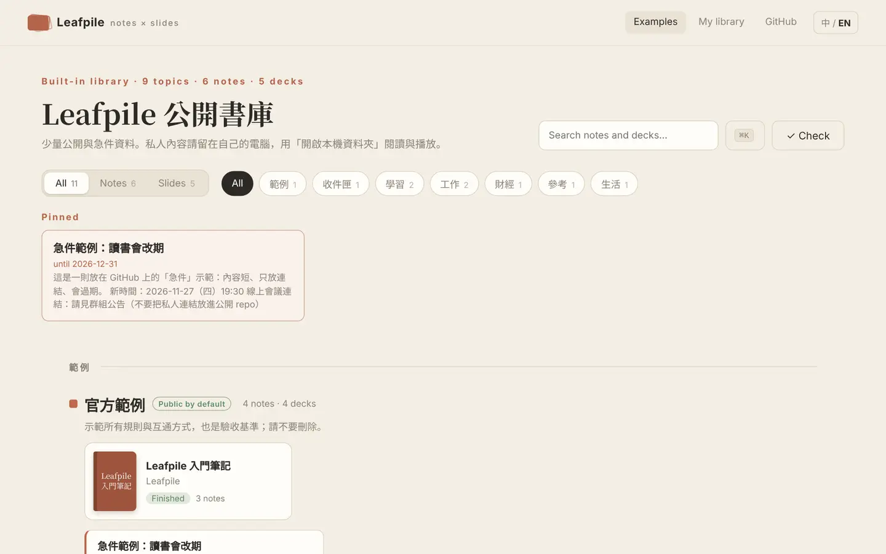
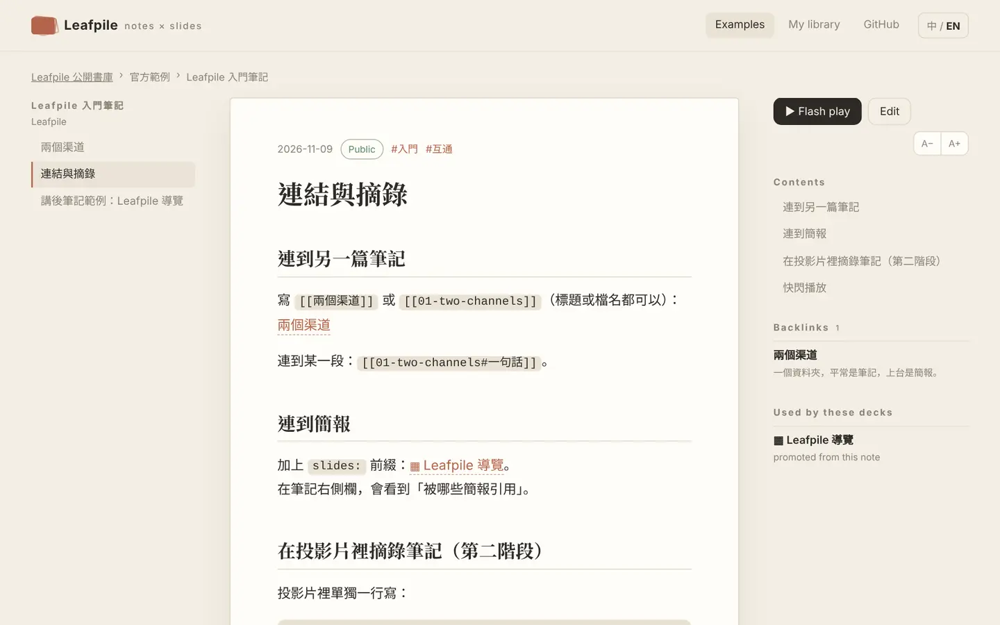
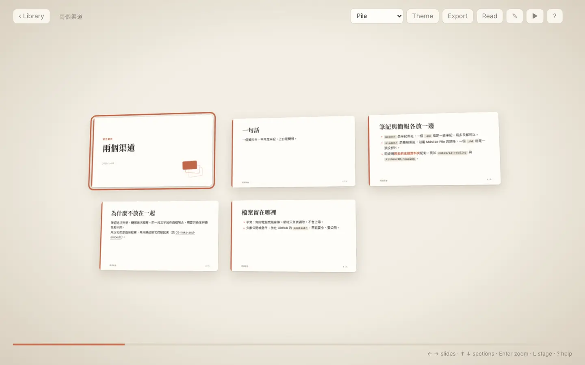

# Leafpile

English · [繁體中文](README.md)

**One folder. Notes by day, slides on stage.**

Leafpile connects two things that are usually done twice: you collect notes in Markdown, promote them into a 3D card-pile slide deck when it is time to share, and save the Q&A back into your notes afterwards. Files stay on your computer or USB drive; the website only reads them. Nothing to install, nothing uploaded.

**Live site: <https://torusmith.github.io/Leafpile/>** · current version v0.2.0 · [Join the public beta](docs/BETA.en.md)



| Reading a note: contents, backlinks, decks that use it | Flash play: a note as a 3D pile of slides |
|---|---|
|  |  |

## The idea

```
my-library/
├─ _site.yml        library settings and categories (optional)
├─ notes/           notes channel: one .md = one note
│  └─ 10-reading/   a topic
├─ slides/          slides channel: Mdslide Pile format, one .md = one slide
│  └─ 10-reading/   same folder name = same topic, paired automatically
├─ boards/          canvases (JSON Canvas)
└─ _archive/        archived files; Leafpile never deletes your files
```

**Notes are the single source of knowledge; a deck is one performance.** Content can be linked or copied once across channels, but is never synced both ways.

| Bridge | Direction | Changes files? |
|---|---|---|
| `[[links]]` and backlinks | both | no |
| ▶ Flash play | play a note as slides, temporarily | no |
| `![[note#heading]]` excerpt | a note section inside a slide | no |
| Promote to deck | note → new deck skeleton | adds files, then they diverge |
| After-talk note | speaker notes and Q&A → new note | adds a file |

Full rules: [`docs/INTEROP.md`](docs/INTEROP.md) (Traditional Chinese). Deck format: [`docs/slides/GUIDE.en.md`](docs/slides/GUIDE.en.md); player manual: [`docs/slides/MANUAL.en.md`](docs/slides/MANUAL.en.md).

## Getting started

1. Download the [starter library](https://github.com/ToruSmith/Leafpile/releases/latest) (`Leafpile-library-*.zip`) and unzip it, or make a folder containing `notes/` and `slides/`.
2. Open <https://torusmith.github.io/Leafpile/> in Chrome or Edge and choose **Open a local folder**. Other browsers can read and present but cannot save.
3. Reconnect later from **Recent libraries** on the home page. The site installs as an app and then works offline.

| To do this | Do this |
|---|---|
| Find anything, run a command | **Ctrl+K** (⌘K on Mac) on any screen |
| Write a note | **+ Note** on the shelf, or drop a `.md` file into `notes/<topic>/` |
| Link | Type `[[` in the editor to pick a note or deck |
| Share a note right now | **▶ Flash play** on the note (or press P). No files are created |
| Build a real deck | **Make a deck** on the note: a new skeleton in `slides/<same topic>/`, independent afterwards |
| Keep what was said | While playing a deck, Ctrl+K → **Save this deck as an after-talk note** |
| Present | Enter to zoom, arrows to move, S speaker view, D pen, P for PDF, export to a single HTML file |
| Check the library | **✓ Check** on the shelf, or `node leafpile-check.mjs` |

A Mdslide Pile library opens as it is (a folder without `notes/` and `slides/` is treated as a deck library).

```bash
node scripts/check.mjs <library>                           # notes, decks and links
node scripts/promote.mjs <library> notes/<topic>/<note>.md  # note → new deck skeleton
node scripts/after-talk.mjs <library> slides/<topic>/<deck>  # deck → after-talk note (--qa qa.json adds the Q&A)
node scripts/source-sync.mjs <library>                    # which decks have a changed source note
node scripts/guard-content.mjs content                     # before pushing to GitHub
node --test tests/*.test.mjs                               # unit tests (Node 18+, no npm install)
```

## What goes on GitHub

GitHub Pages sites are always public, so `content/` is public. Keep it small and public: images ≤ 300 KB, text files ≤ 100 KB, 20 MB in total, videos and PDFs as links only, ASCII paths, and `expires` on pinned urgent notes. Private or work content stays on your computer.

## Lineage

Leafpile merges two projects by the same author: [Mdslide Pile](https://github.com/ToruSmith/Mdslide-Pile) (deck format, local-first engine, zero dependencies) and [reading-notes-vault](https://github.com/ToruSmith/reading-notes-vault) (note front matter, categories and topics, public/private rules, personal-data scan, JSON Canvas boards).

## Contributing, credits, license

See [`CONTRIBUTING.md`](CONTRIBUTING.md), [`CONTRIBUTORS.md`](CONTRIBUTORS.md), [`AI_CREDITS.md`](AI_CREDITS.md), [`SECURITY.md`](SECURITY.md) and [`CODE_OF_CONDUCT.md`](CODE_OF_CONDUCT.md). Code is MIT ([`LICENSE`](LICENSE)); docs and example content are CC BY 4.0 ([`LICENSE-CONTENT.md`](LICENSE-CONTENT.md)). Your own notes and decks remain yours.
