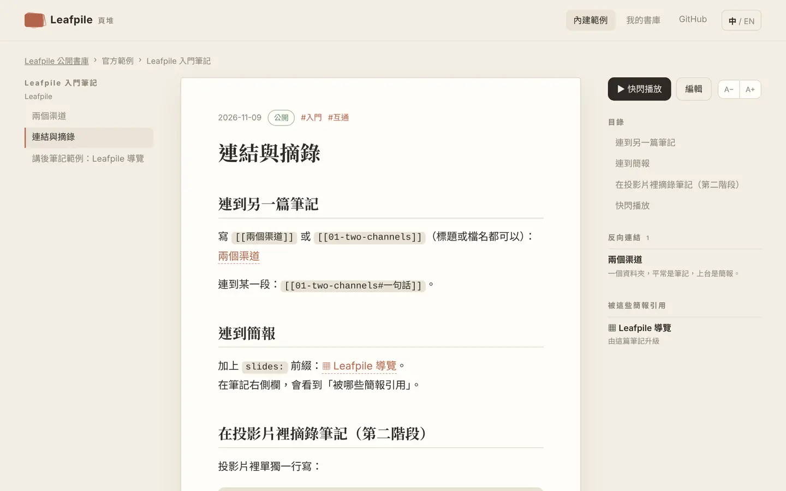
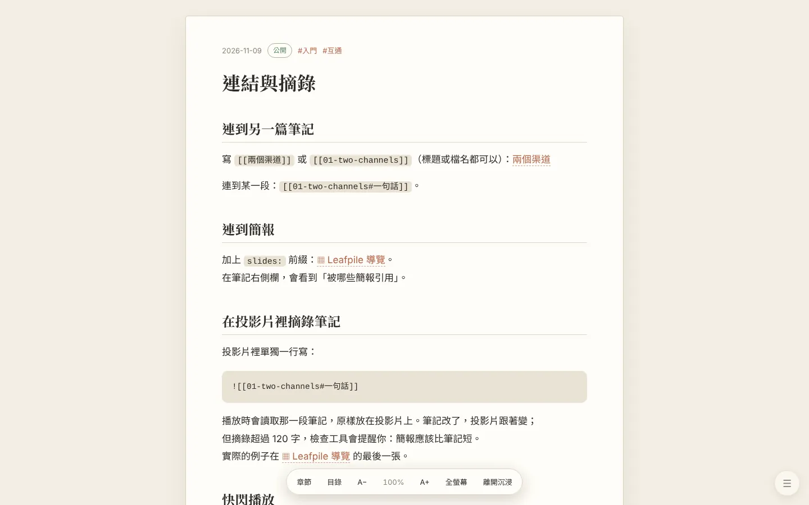
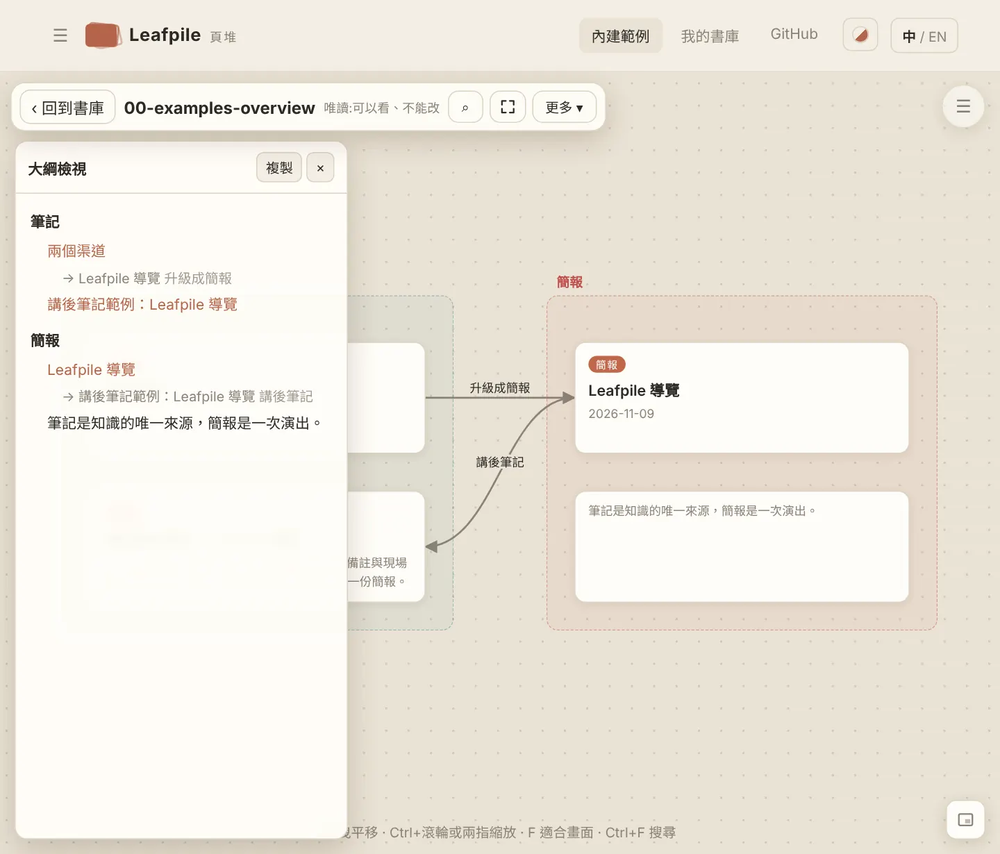
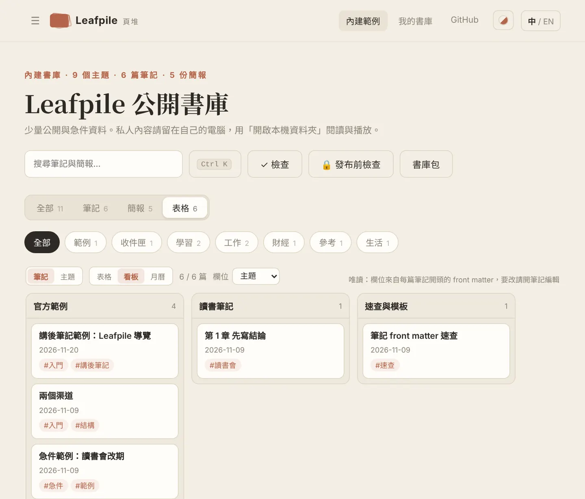
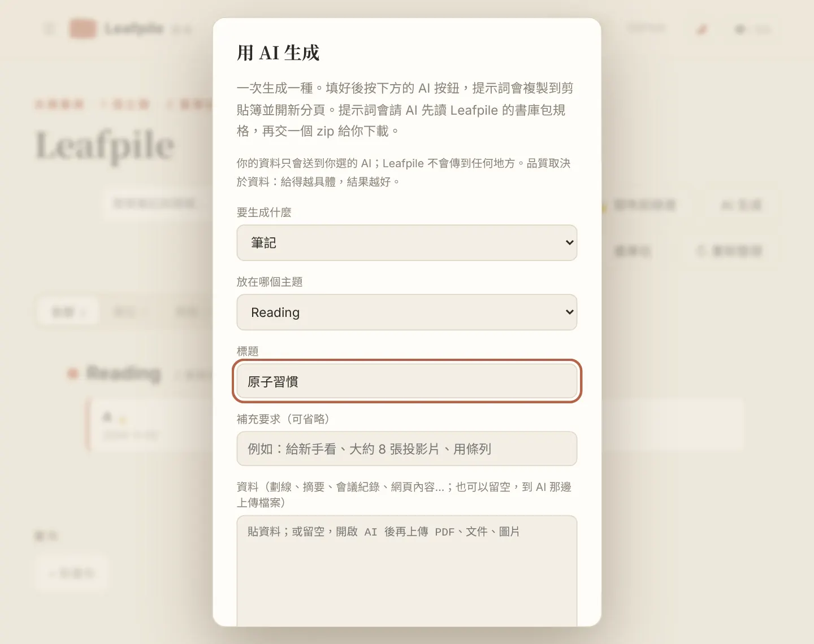

# Leafpile 頁堆

[English](README.en.md) · 繁體中文

**一個資料夾，平常是筆記，上台是簡報。**

Leafpile 把兩件常被分開做的事接起來：用 Markdown 累積筆記，要分享時升級成 3D 牌堆簡報，講完再把問答存回筆記。檔案留在你的電腦或隨身碟，網站只負責讀取，不用安裝、不用上傳。

**線上版：<https://torusmith.github.io/Leafpile/>**　·　目前版本 v0.15.0


| 筆記閱讀：目錄、反向連結、被哪些簡報引用 | 快閃播放：筆記直接變成 3D 牌堆 |
|---|---|
|  |  |

| 沉浸閱讀：只留內文，浮動按鈕列 | 畫布：大綱檢視、小地圖與浮動工具列 |
|---|---|
|  |  |


| 看板：依 `status` 等欄位分欄（唯讀） | 月曆：依日期看筆記（唯讀） |
|---|---|
|  |  |

| 用 AI 生成：複製提示詞，AI 交回書庫包 | 書庫包：匯出、備份、傳給別人 |
|---|---|
|  |  |

## 為什麼

- 讀書時寫一份筆記，要分享時又從頭做一份簡報。
- 講完之後，現場的問答哪裡都沒留下。
- 筆記工具把簡報當附屬外掛；簡報工具不管筆記怎麼累積。

Leafpile 的答案是：**同一個書庫、兩個渠道、中間一座橋。**

## 核心概念

```
我的頁堆/                         ← 書庫（硬碟或隨身碟）
├─ _site.yml                     ← 書庫設定與分類（可省略）
├─ notes/                        ← 筆記渠道：一個 .md 一篇筆記
│  └─ 10-reading/                ← 主題
│     ├─ _topic.yml
│     └─ 2026-11-atomic-habits/  ← 一本書／筆記本（可省略這層）
├─ slides/                       ← 簡報渠道：Mdslide Pile 規格，一個 .md 一張投影片
│  └─ 10-reading/                ← 同名主題 = 同一個主題，自動配對
│     └─ 2026-11-atomic-habits-share/deck.yml
├─ boards/                       ← 畫布（JSON Canvas）
└─ _archive/                     ← 封存，Leafpile 從不刪除你的檔案
```

| | 筆記 `notes/` | 簡報 `slides/` |
|---|---|---|
| 一個 `.md` 是 | 一篇筆記，長短不限 | 一張投影片 |
| 設定 | front matter（與 Obsidian 相容） | `deck.yml`＋每張的版型設定 |
| 版型、背景、字級 | 不寫 | 有十幾種版型 |
| 看的方式 | 書架、閱讀、搜尋、反向連結 | 3D 牌堆、講者視窗、畫筆、匯出單一 HTML |

## 中間那座橋

**筆記是知識的唯一來源，簡報是一次演出。** 內容可以跨渠道引用或複製一次，但永遠不自動雙向同步。

| 走法 | 方向 | 會不會改檔案 |
|---|---|---|
| `[[連結]]` 與反向連結 | 雙向 | 不會 |
| ▶ 快閃播放 | 筆記暫時當簡報播 | 不會 |
| `![[筆記#標題]]` 摘錄嵌入 | 筆記的一段放進投影片 | 不會 |
| 升級成簡報 | 筆記 → 新簡報骨架 | 新增檔案，之後各自獨立 |
| 講後筆記 | 簡報備註與問答 → 新筆記 | 新增檔案 |

完整規則：[`docs/INTEROP.md`](docs/INTEROP.md)。

## 開始使用

> 忘了有什麼功能？看[功能手冊](docs/FEATURES.md)。

1. 下載[最新版的範例書庫](https://github.com/ToruSmith/Leafpile/releases/latest)（`Leafpile-library-*.zip`），解壓到你的電腦或隨身碟。也可以自己建一個資料夾，裡面放 `notes/` 與 `slides/`。
2. 用 Chrome 或 Edge 打開 <https://torusmith.github.io/Leafpile/>，按「開啟本機資料夾」選那個資料夾。其他瀏覽器可以閱讀與播放，但不能存檔。
3. 之後在首頁的「最近開啟的書庫」點一下就能重新連線。網站可以安裝成 App，裝過之後離線也能用。

| 想做的事 | 怎麼做 |
|---|---|
| 找筆記或簡報、執行動作 | 任何畫面按 **Ctrl+K**（Mac 是 ⌘K） |
| 寫筆記 | 書庫首頁搜尋框旁的「+ 筆記」；或直接在 `notes/<主題>/` 放 `.md` 檔（Obsidian、VS Code 都可以） |
| 連結 | 編輯時輸入 `[[`，會列出可以連結的筆記與簡報 |
| 臨時分享一篇筆記 | 筆記右上 **▶ 快閃播放**（或按 P）。不會產生任何檔案 |
| 正式做一份簡報 | 筆記右上「做成簡報」，在 `slides/<同名主題>/` 建立骨架；之後各自獨立 |
| 講完留下紀錄 | 播放簡報時 Ctrl+K →「把這份簡報存成講後筆記」 |
| 上台 | Enter 放大、方向鍵翻頁、S 講者視窗、D 畫筆、P 存成 PDF、匯出單一 HTML |
| 改名、搬移、封存筆記 | 筆記右側「更多 ▾」；連到它的 `[[連結]]` 會自動更新 |
| 把筆記與簡報排在一起 | 書庫首頁的「畫布」→「+ 新畫布」；筆記卡（顯示全文，點標題在側邊直接讀與改）、簡報卡、圖片、網頁、影片、HTML、PDF，拖曳連線、對齊、複製貼上、搜尋、手繪、匯出圖片、小地圖、右鍵選單、全螢幕，還能「▶ 簡報」 |
| 放上 GitHub 之前 | 書庫首頁的「🔒 發布前檢查」：哪些會公開、哪裡可能有個資，還能用訪客視角瀏覽 |
| 專心讀一篇 | 筆記頁按 **F** 進入沉浸閱讀（全螢幕、浮動按鈕列），A− / A+ 有十級字級 |
| 主題很多時找路 | 寬螢幕左側的側邊欄：分類 → 主題 → 筆記本 → 筆記的樹狀目錄，可以釘選、看最近開過 |
| 一次看全部筆記 | 書庫的「表格」：依標題、主題、標籤、日期排序與篩選，還能依分類、主題、月份、標籤等分組並折疊（唯讀） |
| 換外觀 | 頂列的「外觀」：自動、紙張、深色、石板、棕褐、北極 |
| 用 AI 生成筆記、簡報、畫布 | 書庫首頁「AI 生成」：貼上資料 → 複製提示詞並開啟 Claude／ChatGPT／Gemini → 把回覆貼回來，先預覽再匯入 |
| 備份、分享、合併書庫 | 書庫首頁「書庫包」：匯出 zip（整個或只有公開的部分）、匯入 zip／資料夾／AI 的回覆（不覆蓋）；別人給的 zip 在首頁「開啟 zip 書庫包」就能看 |
| 改主題名稱、分類、顏色 | 「表格」切到「主題」→「編輯」，或「管理分類」。先預覽要改哪幾行，寫入後可以復原，手寫註解會保留（需要 Chrome／Edge 開啟的本機資料夾） |
| 檢查書庫 | 書庫首頁的「✓ 檢查」，或 `node leafpile-check.mjs` |

已經有 Mdslide Pile 書庫？直接開啟就能播放（沒有 `notes/` 與 `slides/` 的資料夾會被當成簡報書庫）；把它放進 Leafpile 書庫的 `slides/` 就能和筆記配對。

### 命令列（選用，Node 18 以上，不用 npm install）

```bash
node scripts/check.mjs <書庫>                          # 檢查筆記、簡報與連結（--slides 列出每一張）
node scripts/check.mjs <書庫> --index                  # 書庫索引：所有筆記、簡報、畫布與連結，給 AI 先看全貌（--index=json、--public）
node scripts/promote.mjs <書庫> notes/<主題>/<筆記>.md   # 筆記 → 新簡報骨架（整本筆記本也可以）
node scripts/after-talk.mjs <書庫> slides/<主題>/<簡報>  # 簡報 → 講後筆記（--qa 問答.json 帶入現場問答）
node scripts/source-sync.mjs <書庫>                    # 哪些簡報的來源筆記在升級後改過了
node scripts/new-deck.mjs <資料夾>                      # 空白簡報骨架
node scripts/guard-content.mjs content                 # 放上 GitHub 前的守門檢查
node --test tests/*.test.mjs                           # 單元測試
```

## GitHub 上只放什麼

> ⚠️ GitHub Pages 的網站一律公開。`content/` 裡的每個檔案都會被任何人看到。

- 只放**公開**、**小**、**必要時會過期**的東西：官方範例、公開的讀書分享、急件公告。
- 圖片單檔 ≤ 300 KB（優先 SVG、WebP），文字檔 ≤ 100 KB，總量 ≤ 20 MB；影片與 PDF 一律放連結。
- 路徑只用英文；中文名稱寫在 `_topic.yml` 的 `name` 或 front matter 的 `title`。
- 急件寫 `pinned: true` 與 `expires: 2026-12-31`，到期後守門檢查會提醒下架。
- 私人或公司內容一律留在你的電腦。

預設分類與主題已經放好：範例、收件匣、學習（讀書筆記、課程）、工作（報告、會議）、財經、參考、生活（只留本機）。說明見 [`docs/SPEC.md`](docs/SPEC.md#預設分類與主題)。

## 範例

| 範例 | 位置 | 示範什麼 |
|---|---|---|
| Leafpile 入門筆記 | `content/notes/00-examples/2026-11-leafpile-basics/` | 筆記本、front matter、連結、講後筆記 |
| Leafpile 導覽（13 張） | `content/slides/00-examples/2026-11-leafpile-tour/` | 由上面的筆記升級而來，10 種版型 |
| Feature Tour、深色主題、最小範例 | `content/slides/00-examples/` | 簡報引擎的所有版型、主題與排列（來自 Mdslide Pile） |
| 讀書筆記＋讀書會簡報 | `content/notes/10-reading/…`、`content/slides/10-reading/…` | 同名主題配對、私人主題裡的公開筆記 |
| 急件 | `content/notes/00-examples/urgent-sample.md` | `pinned` 與 `expires` |
| 畫布 | `content/boards/00-examples-overview.canvas` | 筆記卡與簡報卡在同一張畫布 |

所有範例都通過 `node scripts/check.mjs content` 與守門檢查，CI 每次都會重跑。

## 文件

| 文件 | 給誰 |
|---|---|
| [`docs/FEATURES.md`](docs/FEATURES.md) | **功能手冊**：所有功能、快捷鍵、常見工作流程，忘了怎麼用先看這份（[English](docs/FEATURES.en.md)） |
| [`docs/SPEC.md`](docs/SPEC.md) | 存檔規格：資料夾、設定檔、front matter、連結語法（人與 AI 都照這份） |
| [`docs/slides/GUIDE.zh-Hant.md`](docs/slides/GUIDE.zh-Hant.md) | 簡報的完整規則：版型、媒體、圖表、外觀（[English](docs/slides/GUIDE.en.md)） |
| [`docs/slides/MANUAL.zh-Hant.md`](docs/slides/MANUAL.zh-Hant.md) | 簡報播放器的使用手冊：快捷鍵、編輯模式、匯出（[English](docs/slides/MANUAL.en.md)） |
| [`docs/INTEROP.md`](docs/INTEROP.md) | 筆記與簡報怎麼互通、界線在哪 |
| [`docs/ARCHITECTURE.md`](docs/ARCHITECTURE.md) | 系統架構與模組 |
| [`docs/ROADMAP.md`](docs/ROADMAP.md) | 路線圖與每階段的驗收閘門 |
| [`docs/AI_PROMPTS.md`](docs/AI_PROMPTS.md) | 請 AI 幫你寫筆記、做簡報、寫講後筆記的提示詞 |
| [`AGENTS.md`](AGENTS.md) | 給維護本專案的 AI 與人 |

## 血緣

Leafpile 融合了同一位作者的兩個專案：

- [Mdslide Pile](https://github.com/ToruSmith/Mdslide-Pile)：資料夾變成 3D 牌堆簡報。Leafpile 沿用它的簡報規格、本機優先架構、零依賴原則與寫入安全規則。
- [讀書筆記 Vault](https://github.com/ToruSmith/reading-notes-vault)：Apps Script 後端的讀書筆記庫。Leafpile 吸收它的筆記 front matter、分類與主題、公開／私人規則、個資掃描與 JSON Canvas 畫布。

## 參與

- 回報問題或建議功能：開 Issue（有範本）。
- 想改程式或文件：先讀 [`CONTRIBUTING.md`](CONTRIBUTING.md)。
- 安全問題：依 [`SECURITY.md`](SECURITY.md) 私下回報。
- 行為準則：[`CODE_OF_CONDUCT.md`](CODE_OF_CONDUCT.md)。

## 貢獻者與 AI 創作者

- 人類貢獻者：[`CONTRIBUTORS.md`](CONTRIBUTORS.md)
- AI 協作揭露：[`AI_CREDITS.md`](AI_CREDITS.md)。本專案歡迎 AI 協作，但每一行都由人類審閱並負責。

## 授權

程式碼 MIT（[`LICENSE`](LICENSE)）；文件與範例內容 CC BY 4.0（[`LICENSE-CONTENT.md`](LICENSE-CONTENT.md)）。你自己的筆記與簡報著作權屬於你。
