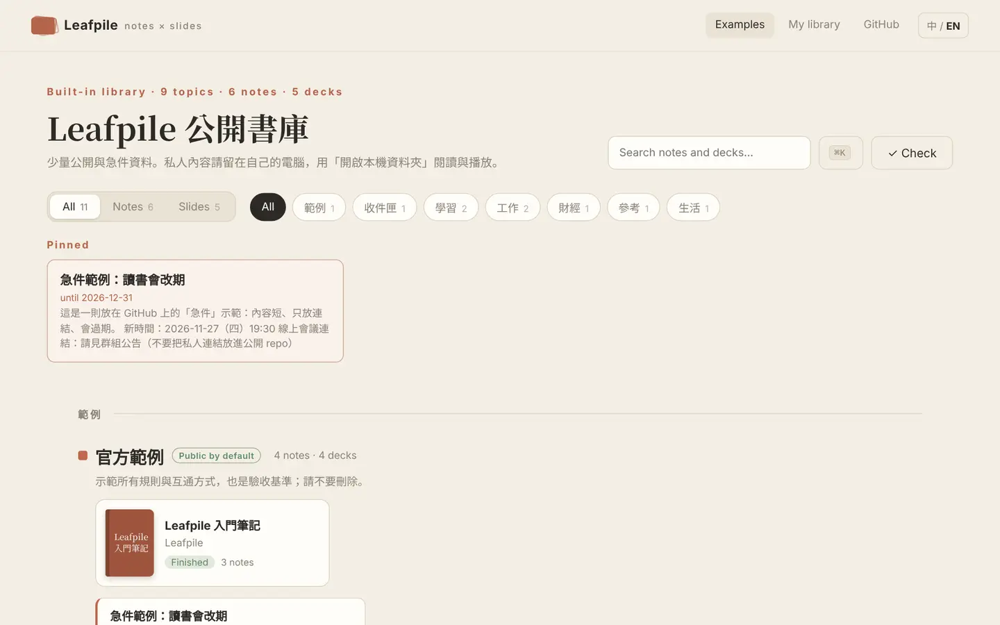
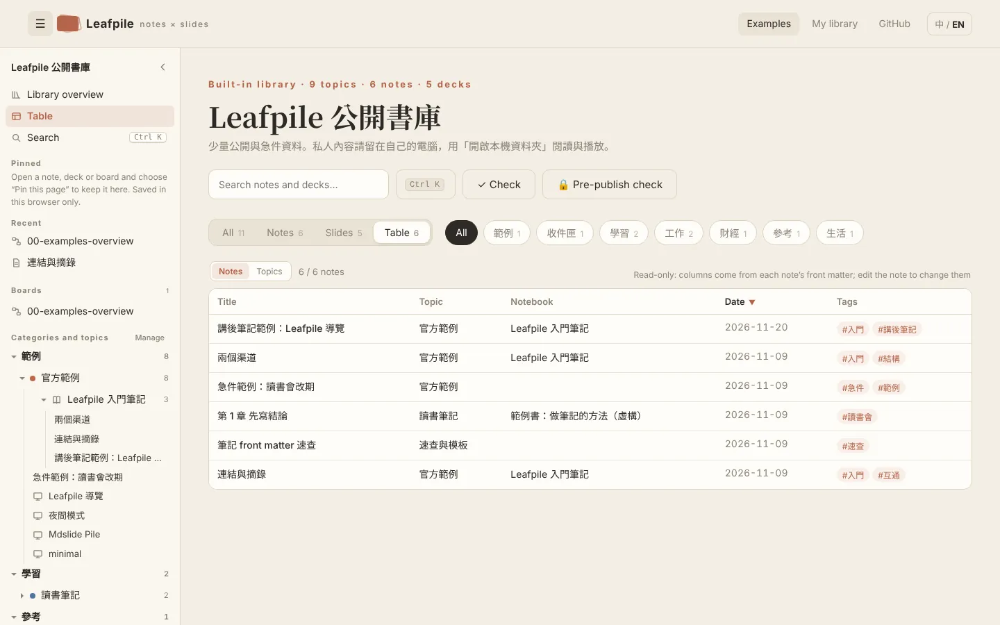
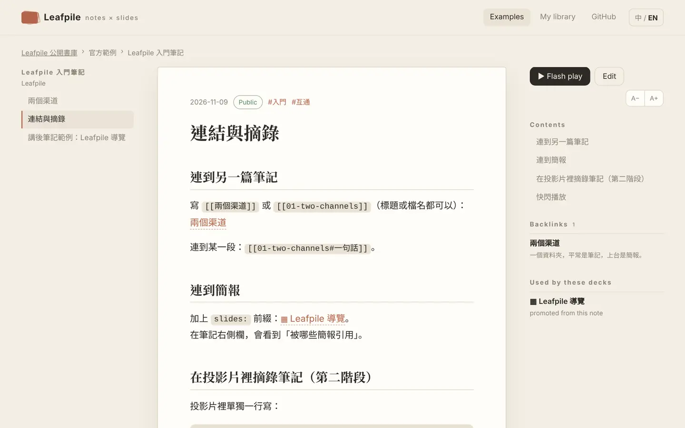
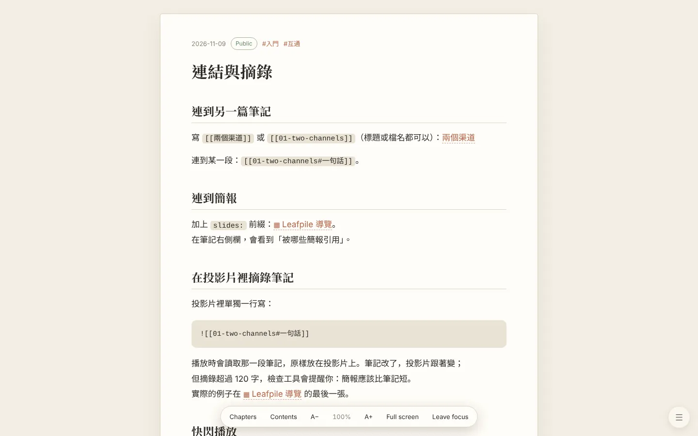
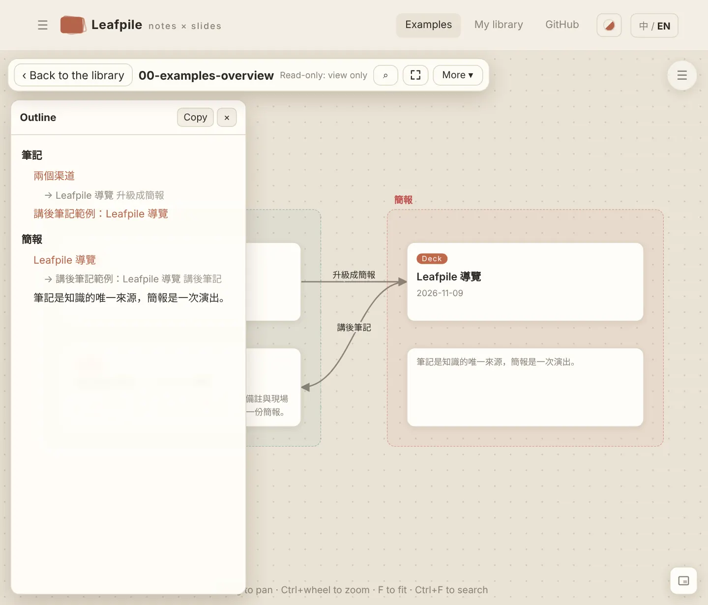

# Feature guide

English · [繁體中文](FEATURES.md)

Start here when you forget what Leafpile can do. For file formats and rules see [`SPEC.md`](SPEC.md) (in Traditional Chinese); for how notes and decks reference each other see [`INTEROP.md`](INTEROP.md).

## Remember these three

| Key | Where | What it does |
|---|---|---|
| **Ctrl+K** (⌘K on Mac) | Everywhere | Command palette: search notes and decks, and run commands such as "New note", "Check this library", "Switch language" |
| **/** | Library page | Jump to the search box |
| **F** | Note, board, deck | Note: focus reading. Board: fit to screen. Deck: full screen |

## I want to…

| I want to | Go to |
|---|---|
| Find a note or deck | Ctrl+K, or the search box on the library page (it also searches note text) |
| Add a note | **+ Note** on the library page, or Ctrl+K → "New note" |
| Read without distraction | Press **F** on a note (focus reading) |
| Change the text size | A− / A+ at the top right of a note, or press **+** / **−** (ten steps, 0.8× to 2.2×) |
| See every note, sorted by date or tag | **Table** on the library page |
| Fold many notes by topic or month | **Table** → **Group by** |
| Change colors, use dark mode | **Appearance** in the top bar |
| Let an AI understand the whole library first | `node leafpile-check.mjs <library> --index` |
| Find my way across many topics | The sidebar on the left (see below) |
| Rename a topic, change its category or color | **Table** → **Topics** → **Edit** |
| Play a note as a deck for a moment | Press **P** on a note (flash play); no file is created |
| Make a real deck | **Make a deck** at the top right of a note |
| Keep the Q&A after a talk | While playing, Ctrl+K → "Save this deck as an after-talk note" |
| Lay out notes, decks and images and think | **Boards** on the library page → **+ New board** |
| Check for personal data before pushing to GitHub | **🔒 Pre-publish check** on the library page |
| Find broken links | **✓ Check** on the library page |
| Rename or move a note | **More ▾** on the note → Rename / Move (links to it update automatically) |
| Get rid of a note | **More ▾** → Archive (moved to `_archive/`, never deleted) |

## Opening a library

- **Built-in examples**: "Examples" on the home page. Read-only, for looking around.
- **My library**: "Open local folder" on the home page. Only **Chrome and Edge** can save; other browsers can read and play but not edit.
- Next time, click the library under "Recent libraries" on the home page. The browser may ask for write permission again.
- The site installs as an app and works offline once installed.

## Library page

### Views

The switch at the top: **All** (notes and decks together, grouped by category), **Notes**, **Slides**, **Table**. The category chips on the right filter by category. Urgent notes (`pinned: true`, not expired) stay on top.

### Sidebar

Docked on the left on wide screens (1101 px and up); on narrow screens, open it with ☰ at the top left. The ❮ button collapses it.

| Section | Notes |
|---|---|
| Library overview, Table, Search | Switch views; Search is the same as Ctrl+K |
| Pinned | On a note, deck or board page, press **Pin** in the sidebar; press again to unpin |
| Recent | Recorded automatically, up to six |
| Boards | All boards in this library |
| Categories and topics | A tree of category → topic → notebook → notes and decks; the current page opens and is marked automatically |

Note: pins, recents and whether the sidebar is collapsed are stored **only in this browser**. They are not written into your library files and don't follow you to another computer. The sidebar in guest view (pre-publish check) lists public notes only.

### Table (read-only)

- **Notes**: title, topic, notebook, date, tags, plus any fields you define in front matter (such as `status` or `rating`, up to 6 columns). Click a column heading to sort; filter at the top.
- **Topics**: each topic's folder, category, note count, deck count and default visibility.

**Grouping and folding**: the **Group by** menu groups rows by category, topic, notebook, year, month, tag, or any custom field (such as `status`). Each group has a heading row; click it to collapse or expand, or use **Collapse all / Expand all**. When grouping by tags or a list field, a note appears once per tag. The **Topics** mode can group by category. The grouping and which groups are collapsed are remembered in this browser.

### Topic management

Under **Table** → **Topics**:

| Button | What it does | File it changes |
|---|---|---|
| Edit | Change name, description, category, color, public by default | The topic's `_topic.yml` |
| New topic | Create a topic; suggests a folder prefix (such as `60-`) | Adds `notes/<folder>/_topic.yml` |
| Manage categories | Rename, recolor, reorder, add, and delete unused categories | `categories` in `_site.yml` |

- Every change is previewed first: which file, which lines. Nothing is written until you confirm.
- After writing, the toast has **Undo**, which writes the previous content back.
- If the file was changed elsewhere in the meantime, nothing is written; reload and try again.
- Your hand-written YAML comments are kept. The one exception is the `categories` block in `_site.yml`, which is rewritten as a whole, so comments inside it are lost (the preview warns you first).
- "Changing a category" moves one topic under a different category. Renaming a category only changes its display name; its id stays the same.
- Reordering topics, renaming topic folders and merging topics are not offered yet. Topic order comes from the number at the start of the folder name.

## Notes

### Reading

The right column has the table of contents, backlinks (who links here), "Used by these decks" and "Appears on these boards". The left and right arrow keys move to the previous or next note in the same notebook.

| Key | What it does |
|---|---|
| ← / → | Previous / next note (same notebook) |
| **F** | Focus reading |
| **P** | Flash play |
| **E** | Edit (writable libraries) |
| **+** / **−** | Larger / smaller text |

### Focus reading

Press **F**. The sidebar and top bar disappear, leaving only the text and a floating bar at the bottom: chapters, table of contents, A− / A+, full screen, leave focus. **Esc** leaves full screen first; a second **Esc** leaves focus reading. The bar hides after a while; move the mouse to the bottom of the screen, or tap the ☰ at the bottom right, to bring it back (on a phone, use ☰).

### Editing

| Key / action | What it does |
|---|---|
| Editor on the left, live preview on the right | The preview follows as you type |
| Type `[[` | Lists notes and decks to link; `[[slides:` lists decks only; ↑↓ to choose, Enter or Tab to accept, Esc to cancel |
| **Ctrl+S** | Save |
| **Ctrl+B** | Bold |
| Toolbar | Bold, heading, list, checkbox, quote, link |

- You are warned before leaving with unsaved changes, and drafts are protected.
- If the file was changed by another program (for example Obsidian) while you edit, saving stops and asks instead of overwriting.
- Front matter fields: see [`SPEC.md`, section 4](SPEC.md).

### Link syntax

| Write | Meaning |
|---|---|
| `[[note]]` | Link to a note (matched by title, alias or file name) |
| `[[note#heading]]` | Link to one section |
| `[[note\|text]]` | Custom link text |
| `[[slides:deck]]` | Link to a deck |
| `![[note#heading]]` | Excerpt a section of a note inside a slide |

### More ▾ (rename, move, archive)

- **Rename** and **Move** first list which files will change along with it (`[[links]]` to it, a deck's `source`, cards on boards) and only proceed after you confirm. If the destination already has a file of that name, it refuses and never overwrites.
- **Archive** moves it to `_archive/`, and removes the original only after reading the copy back to confirm it is complete.
- Leafpile never really deletes your files.

## Decks

Use **Make a deck** on a note, or open a deck from the library page. Deck format, layouts and writing are in [`slides/MANUAL.en.md`](slides/MANUAL.en.md).

### Keys while playing

Press **?** at any time for this list.

| Key | What it does |
|---|---|
| ← / → or PageUp / PageDown | Previous / next slide |
| ↑ / ↓ | Previous / next chapter |
| Home / End | First / last slide |
| Enter or Space | Zoom in / back out |
| Esc | Back out, leave overview, return to the contents |
| **O** | Overview |
| **V** | Side-by-side mode (large view plus thumbnails) |
| **G** | Jump to a slide number |
| **M** | Reading mode (with notes) |
| **E** | Edit this slide's source (writable libraries) |
| **D** | Pen and laser pointer; **X** clears this slide's drawing |
| **L** | Switch layout |
| **T** | Switch theme |
| **B** or **.** | Black screen |
| **F** | Full screen |
| **S** | Open the presenter window (notes, timer, Q&A) |
| **P** | Print / save as PDF |
| **K** | Play / pause a local video while zoomed in |
| **R** | Reload the deck |

The presenter window has a Q&A tab, which you can save as an after-talk note. A deck can be exported as a single HTML file that anyone can open without installing anything.

## Between notes and decks

A note is the single source of knowledge; a deck is one performance. Content can be referenced or copied once, but is never synced both ways automatically.

| Route | What it does | Changes files? |
|---|---|---|
| Flash play (P) | Play a note as a deck, temporarily | No |
| `![[note#heading]]` excerpt | Reads a section of a note while playing | No |
| Make a deck | One note or a whole notebook → deck skeleton | Adds files; independent afterwards |
| After-talk note | Deck notes and Q&A → a new note | Adds a file |
| Source reminder | A deck warns you when its source note changed after the upgrade; mark it "synced" once handled | Only `source_hash` in `deck.yml` |

## Boards

A board is an infinite whiteboard for note cards, deck cards, text, images, web pages, videos, HTML and PDF, joined by lines. The file is `boards/*.canvas` (JSON Canvas, which Obsidian can open too).

### Toolbar

A floating toolbar at the top left: back to the library, board name, search, full screen, "More ▾". After a while without activity it hides; move the mouse to the top, or click the ☰ at the top right, to bring it back. **Keep toolbar visible** in the More menu pins it.

| Where | Items |
|---|---|
| On the toolbar (common) | + Text, + Note or deck (in "More" on narrow screens), ↶ Undo, ⌕ Search, Full screen, More ▾ |
| More ▾ | + URL (a link card, or embed a web page, video or Google Slides), + Image or file, ✎ Draw (becomes an image card), ▶ Present, Export (PNG / SVG, selection or whole board), Minimap, Keep toolbar visible, Zoom (− 100% +) |
| Bottom right | Minimap toggle; drag inside the minimap to move the view |

Read-only boards (the built-in examples, or a library you can't write to) have no add or edit items.

### Keys and gestures

| Action | What it does |
|---|---|
| Drag empty space | Pan |
| Shift + click a card | Add to / remove from the selection |
| Shift + drag empty space | Box select |
| Ctrl + wheel, or pinch | Zoom |
| **F** | Fit to screen |
| **0** | Back to 100% |
| **+** / **−** | Zoom in / out |
| **M** | Toggle the minimap |
| Double-click empty space | New text card |
| Enter | Edit the selected text card; open a note or deck card |
| Delete | Delete the selection |
| Esc | Cancel one layer at a time: context menu, More menu, search, selection, full screen |
| **Ctrl+A / C / X / D** | Select all, copy, cut, duplicate |
| **Ctrl+V** | Paste (also pastes screenshots as image cards) |
| **Ctrl+Z / Ctrl+Y** | Undo / redo |
| **Ctrl+F** | Search within the board |
| Drag an image, HTML or PDF onto the board | Becomes a card, stored in `boards/media/` |

### Right-click menu

Right-click empty space, a card or a line (on a phone: select it, then tap ⋯).

- Empty space: new text / note or deck / URL, paste, fit to screen, minimap.
- Card: open, edit, focus, copy, cut, duplicate, paste, group, bring to front / send to back, change color, delete. A text card can become a note; a group can become an outline note.
- Line: edit text, change color, delete.

### Present mode

More ▾ → "▶ Present": zooms into one group at a time (or one card at a time if there are no groups); ← / → to move, Esc to leave.

### Phones

Phones have a full-screen button too (when the browser can't do real full screen, the board simply fills the whole window). The toolbar hides itself; tap the ☰ at the top right to bring it back. Pinch to zoom and drag with one finger to pan.

## Appearance

The round swatch button next to 中/EN in the top bar is **Appearance**: Automatic, Paper, Ink, Slate, Sepia, Nord.

- **Automatic** uses `theme` from the library's `_site.yml`, or Ink when your computer is in dark mode.
- Any other choice changes the library, notes and boards. **Decks keep the `theme` in their own `deck.yml`** (press T while playing to try others). Sepia and Nord can be used in `deck.yml` too.
- The choice is stored in this browser only. You can also step through themes with Ctrl+K → "Switch appearance".
- Text contrast in every theme is checked by tests, so no combination is hard to read.

## Checking and publishing

| Feature | Where | Notes |
|---|---|---|
| ✓ Check | Library page | Finds broken links, duplicate names, and settings or decks that break the rules; from the command line: `node leafpile-check.mjs <folder>` |
| Library index | Command line | `node leafpile-check.mjs <folder> --index` lists every note (path, date, tags, fields, sections), what it links to, what links to it and which boards it is on. Hand it to an AI first so it sees the whole library; `--index=json` prints JSON and `--public` lists public notes only. Usage and prompts: [`AI_PROMPTS.md`](AI_PROMPTS.md) |
| 🔒 Pre-publish check | Library page | Lists which notes will be public and flags possible personal data (email, phone numbers starting 09xx, Taiwan ID numbers; it only warns, never blocks). Switch to "guest view" to browse and confirm private content doesn't show |

Public or private is decided in this order: the note's `public` → the notebook's `_book.yml` → the topic's `_topic.yml` → if none says so, private.

## Where settings live

| Setting | Stored in | Follows you to another computer? |
|---|---|---|
| Notes, decks, boards, topics, categories | Files in the library folder | Yes (with the folder) |
| Language, appearance, text size, view (All / Table), table grouping and folding, sidebar collapsed, pins, recents, board toolbar and minimap preferences | This browser's local storage | No |

## FAQ

**I opened a folder but can't save?** Only Chrome and Edge can write to a local folder, and you must click "Allow" when the browser asks.

**Keep being asked to "save changes", or see "No write permission"?** The browser is asking whether Leafpile may write into your folder. Press Leafpile's **Allow**, then choose "Save changes" or "Allow" in the browser's prompt. If you cancel, the board pauses auto-save and stops asking; press **Retry save** in the toolbar or Ctrl+S when you want to save.

**It says "the file was changed by another program"?** Obsidian or another program edited the same file while Leafpile had it open. Reload and edit again; the other change is never overwritten.

**A note is missing from the sidebar?** The sidebar lists notes under categories and topics; reload once if the note is new or hasn't been read yet. Guest view lists public notes only.

**Changed a topic by mistake?** The toast after writing has **Undo**. If it's too late, edit that `_topic.yml` in any editor; it's just a plain text file.
