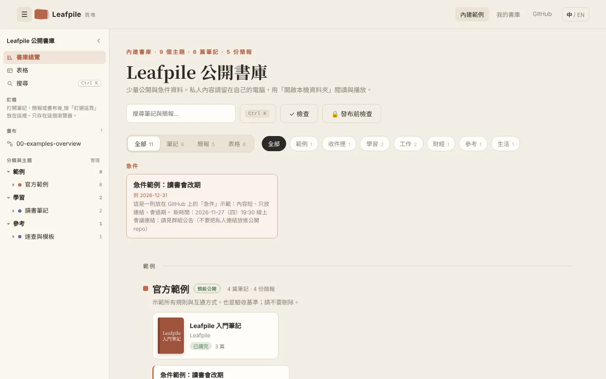
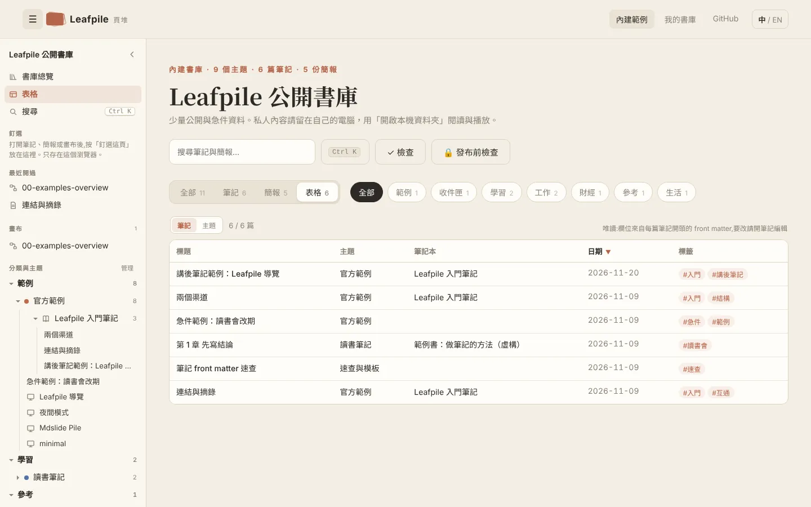
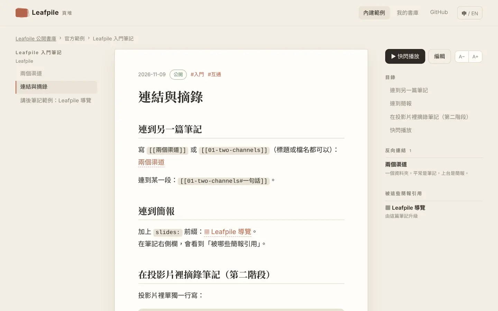
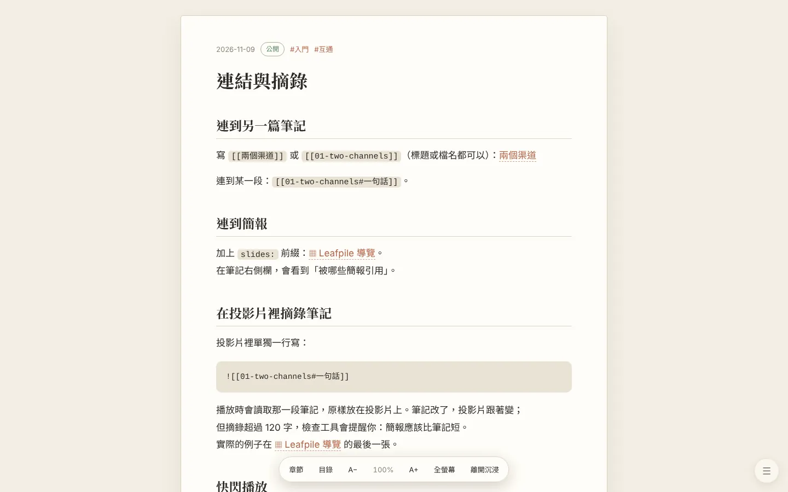
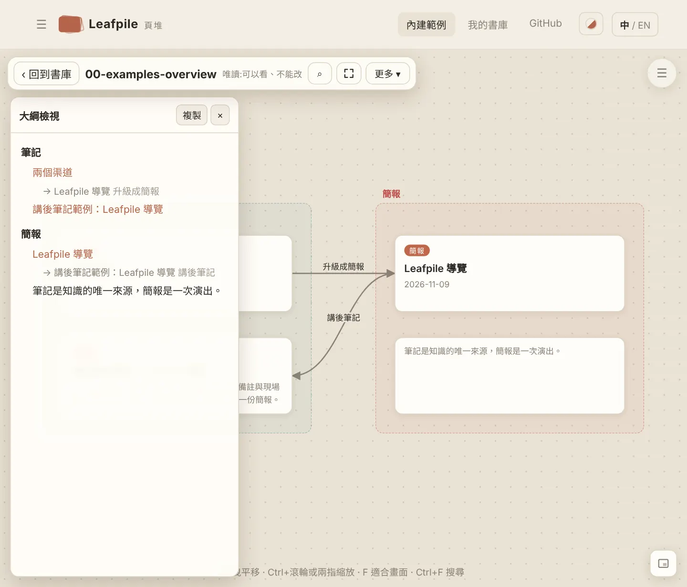

# 功能手冊

[English](FEATURES.en.md) · 繁體中文

忘了有什麼功能時，從這裡找。想知道檔案格式與規則，看 [`SPEC.md`](SPEC.md)；筆記與簡報怎麼互相引用，看 [`INTEROP.md`](INTEROP.md)。

## 先記住這三個

| 按鍵 | 在哪裡 | 做什麼 |
|---|---|---|
| **Ctrl+K**（Mac 是 ⌘K） | 任何畫面 | 指令面板：搜尋筆記與簡報，也能執行「新增筆記」「檢查這個書庫」「切換語言」等指令 |
| **/** | 書庫首頁 | 跳到搜尋框 |
| **F** | 筆記頁、畫布、簡報 | 筆記：沉浸閱讀；畫布：適合畫面；簡報：全螢幕 |

## 我想……

| 我想 | 去哪裡 |
|---|---|
| 找一篇筆記或簡報 | Ctrl+K；或書庫首頁搜尋框（也會搜筆記內文） |
| 新增筆記 | 書庫首頁「+ 筆記」，或 Ctrl+K →「新增筆記」 |
| 專心讀一篇 | 筆記頁按 **F**（沉浸閱讀） |
| 字太小或太大 | 筆記頁右上 A− / A+，或按 **+** / **−**（十級，0.8 到 2.2 倍） |
| 一次看全部筆記，用日期或標籤排序 | 書庫「表格」 |
| 筆記很多，想依主題或月份收起來整理 | 書庫「表格」→「分組」 |
| 換個顏色、深色模式 | 頂列的「外觀」按鈕 |
| 讓 AI 先看懂整個書庫 | `node leafpile-check.mjs <書庫> --index` |
| 用 AI 把資料變成筆記、簡報或畫布 | 書庫首頁「AI 生成」 |
| 備份，或把書庫傳給別人 | 書庫首頁「書庫包」→ 匯出 |
| 看別人給的 zip 書庫包 | 首頁「開啟 zip 書庫包」（任何瀏覽器） |
| 把 zip、資料夾或 AI 的回覆併進我的書庫 | 書庫首頁「書庫包」→ 匯入（先預覽，不覆蓋） |
| 主題太多，找不到路 | 左側的側邊欄（見下方） |
| 改主題名稱、分類、顏色 | 書庫「表格」→「主題」→「編輯」 |
| 把筆記臨時當簡報播 | 筆記頁按 **P**（快閃播放），不會產生任何檔案 |
| 正式做一份簡報 | 筆記頁右上「做成簡報」 |
| 講完存問答 | 播放簡報時 Ctrl+K →「把這份簡報存成講後筆記」 |
| 把筆記、簡報、圖片排在一起想事情 | 書庫首頁「畫布」→「+ 新畫布」 |
| 放上 GitHub 前確認沒有個資 | 書庫首頁「🔒 發布前檢查」 |
| 檢查連結有沒有壞掉 | 書庫首頁「✓ 檢查」 |
| 改筆記檔名或換主題 | 筆記頁「更多 ▾」→ 改名／搬移（連到它的 `[[連結]]` 會自動更新） |
| 不想要某篇筆記了 | 筆記頁「更多 ▾」→ 封存（移到 `_archive/`，不會刪除） |

## 開啟書庫

- **內建範例**：首頁「內建範例」，唯讀，用來看功能。
- **我的書庫**：首頁「開啟本機資料夾」。只有 **Chrome 與 Edge** 能存檔；其他瀏覽器可以讀、可以播放，但不能改。
- 下次從首頁的「最近開啟的書庫」點一下就能重新連線，瀏覽器可能會再問一次寫入權限。
- 網站可以安裝成 App，裝過之後離線也能開。
- **zip 書庫包**：首頁「開啟 zip 書庫包」，不用解壓縮，任何瀏覽器（含手機）都能看，唯讀。也可以把 zip 直接拖進網站。

## 書庫首頁

### 檢視

上方的切換鈕：**全部**（筆記與簡報一起，依分類分組）、**筆記**、**簡報**、**表格**。右邊的分類鈕可以只看某一類。急件（`pinned: true` 且沒過期）固定放在最上面。

### 側邊欄

寬螢幕（寬度 1101 px 以上）固定在左側，窄螢幕按左上 ☰ 滑出。按 ❮ 可以收起。

| 區塊 | 說明 |
|---|---|
| 書庫總覽、表格、搜尋 | 切換檢視；搜尋等於 Ctrl+K |
| 釘選 | 在筆記、簡報或畫布頁按側邊欄的「釘選這頁」；再按一次取消 |
| 最近開過 | 自動記錄，最多六筆 |
| 畫布 | 這個書庫所有畫布 |
| 分類與主題 | 分類 → 主題 → 筆記本 → 筆記與簡報的樹狀目錄；目前這篇會自動展開並標出 |

注意：釘選、最近開過、側邊欄收合與否，**只存在這個瀏覽器**，不會寫進書庫檔案，換電腦不會跟著走。訪客視角（發布前檢查）的側邊欄只列公開的筆記。

### 表格（唯讀）

- **筆記**：標題、主題、筆記本、日期、標籤，再加上你在 front matter 自訂的欄位（例如 `status`、`rating`，最多 6 欄）。點欄位標題排序，上方可以篩選。
- **主題**：每個主題的資料夾、分類、筆記數、簡報數、預設公開。

**分組與折疊**：上方的「分組」選單可以依分類、主題、筆記本、年、月、標籤，或任何自訂欄位（例如 `status`）分組。每組有一列標題，點一下就能收起或展開；也有「全部收起／全部展開」。用標籤或清單欄位分組時，一篇筆記有幾個標籤就會出現在幾組。「主題」模式可以依分類分組。分組方式和收起了哪些組會記在這個瀏覽器。

### 主題管理

在「表格」→「主題」裡：

| 按鈕 | 做什麼 | 改到哪個檔案 |
|---|---|---|
| 編輯 | 改名稱、說明、分類、顏色、預設公開 | 該主題的 `_topic.yml` |
| 新增主題 | 建立新主題，會建議資料夾名稱的開頭（例如 `60-`） | 新增 `notes/<資料夾>/_topic.yml` |
| 管理分類 | 分類改名、改色、調順序、新增、刪除沒在用的 | `_site.yml` 的 `categories` |

- 寫入前一定先預覽「要改哪個檔案、哪幾行」，確認才寫。
- 寫入後提示上有「復原」，會把原本的內容寫回去。
- 檔案在別處被改過就不寫入，請重新整理後再試。
- 你手寫的 YAML 註解會保留；唯一例外是 `_site.yml` 的 `categories` 整段會重新寫出，段落裡的註解會不見（預覽時會先提醒）。
- 「換分類」是把一個主題搬到另一個分類底下；分類「改名」只改顯示名稱，分類代號不變。
- 主題之間的順序、改資料夾名稱、合併主題目前不做，順序由資料夾名稱開頭的數字決定。

## 筆記

### 閱讀

右側欄有目錄、反向連結（誰連到這篇）、被這些簡報引用、出現在這些畫布。左右方向鍵切換同一個筆記本的上一篇與下一篇。

| 按鍵 | 做什麼 |
|---|---|
| ← / → | 上一篇／下一篇（同一個筆記本） |
| **F** | 沉浸閱讀 |
| **P** | 快閃播放 |
| **E** | 編輯（可寫入的書庫） |
| **+** / **−** | 放大／縮小字級 |

### 沉浸閱讀

按 **F** 進入：隱藏側邊欄與頂列，只留內文，下方有浮動按鈕列：章節、目錄、A− / A+、全螢幕、離開沉浸。按 **Esc**：先離開全螢幕，再按一次離開沉浸。按鈕列一段時間沒動作會自動收起；滑鼠移到畫面下方，或點右下角的 ☰ 會再出現（手機只能點 ☰）。

### 編輯

| 按鍵／動作 | 做什麼 |
|---|---|
| 左邊編輯、右邊即時預覽 | 預覽跟著輸入更新 |
| 輸入 `[[` | 列出可以連結的筆記與簡報；輸入 `[[slides:` 只列簡報；↑↓ 選、Enter 或 Tab 確定、Esc 取消 |
| **Ctrl+S** | 存檔 |
| **Ctrl+B** | 粗體 |
| 工具列 | 粗體、標題、清單、核取方塊、引言、連結 |

- 編輯中離開頁面會提醒；也有草稿保護。
- 存檔時如果檔案已經被別的程式改過（例如 Obsidian），會停下來問你，不會蓋掉。
- 筆記的 front matter 欄位見 [`SPEC.md` 第 4 節](SPEC.md)。

### 連結語法

| 寫法 | 意思 |
|---|---|
| `[[筆記]]` | 連到筆記（比對標題、別名、檔名） |
| `[[筆記#標題]]` | 連到某一段 |
| `[[筆記\|顯示文字]]` | 自訂顯示文字 |
| `[[slides:簡報]]` | 連到簡報 |
| `![[筆記#標題]]` | 在投影片裡摘錄筆記的一段 |

### 更多 ▾（改名、搬移、封存）

- **改名**、**搬移**：會先列出哪些檔案要跟著改（連到它的 `[[連結]]`、簡報的 `source`、畫布上的卡片），確認後才動；新位置已經有同名檔會拒絕，不覆蓋。
- **封存**：移到 `_archive/`，讀回確認內容完整後才移除原檔。
- Leafpile 從不真的刪除你的檔案。

## 簡報

筆記頁右上「做成簡報」，或書庫首頁開一份簡報。簡報的格式、版型與寫法見 [`slides/MANUAL.zh-Hant.md`](slides/MANUAL.zh-Hant.md)。

### 播放時的按鍵

按 **?** 隨時看這份清單。

| 按鍵 | 做什麼 |
|---|---|
| ← / → 或 PageUp / PageDown | 上一張／下一張 |
| ↑ / ↓ | 上一章／下一章 |
| Home / End | 第一張／最後一張 |
| Enter 或空白鍵 | 放大／縮回 |
| Esc | 縮回、離開總覽、回目錄 |
| **O** | 總覽 |
| **V** | 對照模式（大圖＋縮圖列） |
| **G** | 跳到第幾張 |
| **M** | 閱讀模式（附備註） |
| **E** | 編輯這張的原始碼（可寫入的書庫） |
| **D** | 畫筆與雷射筆；**X** 清除這張的畫 |
| **L** | 切換排列 |
| **T** | 切換主題 |
| **B** 或 **.** | 黑屏 |
| **F** | 全螢幕 |
| **S** | 開啟講者視窗（備註、計時、問答） |
| **P** | 列印／存成 PDF |
| **K** | 放大時播放／暫停本機影片 |
| **R** | 重新載入簡報 |

講者視窗有「問答」分頁，講完可以存成講後筆記。簡報可以匯出成單一 HTML 檔，給沒有安裝任何東西的人直接開。

## 筆記與簡報之間

筆記是知識的唯一來源，簡報是一次演出；內容可以引用或複製一次，但不會自動雙向同步。

| 走法 | 做什麼 | 會不會改檔案 |
|---|---|---|
| 快閃播放（P） | 筆記暫時當簡報播 | 不會 |
| `![[筆記#標題]]` 摘錄 | 播放時讀取筆記的一段 | 不會 |
| 做成簡報 | 單篇或整本筆記本 → 簡報骨架 | 新增檔案，之後各自獨立 |
| 講後筆記 | 簡報備註與問答 → 新筆記 | 新增檔案 |
| 來源提醒 | 來源筆記在升級後改過，簡報會提醒；處理完可標記「已同步」 | 只改 `deck.yml` 的 `source_hash` |

## 畫布

畫布是無限大的白板，放筆記卡、簡報卡、文字、圖片、網頁、影片、HTML、PDF，用線連起來。檔案是 `boards/*.canvas`（JSON Canvas，Obsidian 也能開）。

### 工具列

左上浮動工具列：回到書庫、畫布名稱、搜尋、全螢幕、「更多 ▾」。一段時間沒動作會自動收起，滑鼠移到上方或點右上 ☰ 再出現；在「更多」選單裡可以「固定工具列」。

| 位置 | 項目 |
|---|---|
| 工具列上（常用） | + 文字、+ 筆記或簡報（窄螢幕放在「更多」裡）、↶ 復原、⌕ 搜尋、全螢幕、更多 ▾ |
| 更多 ▾ | + 網址（連結卡，或直接嵌入網頁、影片、Google 簡報）、+ 圖片或檔案、✎ 手繪（畫完變成一張圖片卡）、▶ 簡報、匯出（PNG／SVG，選取的或整張）、大綱檢視、小地圖、固定工具列、縮放（− 100% +） |
| 右下角 | 小地圖開關；小地圖上拖曳可以移動視野 |

唯讀的畫布（內建範例、不能寫入的書庫）沒有新增與編輯的項目。

### 按鍵與手勢

| 操作 | 做什麼 |
|---|---|
| 拖曳空白處 | 平移 |
| Shift＋點卡片 | 加選／取消選取 |
| Shift＋拖曳空白處 | 框選 |
| Ctrl＋滾輪，或兩指縮放 | 縮放 |
| **F** | 適合畫面 |
| **0** | 回到 100% |
| **+** / **−** | 放大／縮小 |
| **M** | 小地圖開關 |
| **O** | 大綱檢視開關 |
| 雙擊空白處 | 新增文字卡 |
| Enter | 編輯選取的文字卡；筆記／簡報卡則開啟 |
| Delete | 刪除選取 |
| Esc | 逐層取消：右鍵選單、更多選單、搜尋、選取、全螢幕 |
| **Ctrl+A / C / X / D** | 全選、複製、剪下、複製一份 |
| **Ctrl+V** | 貼上（也能貼截圖，直接變成圖片卡） |
| **Ctrl+Z / Ctrl+Y** | 復原／重做 |
| **Ctrl+F** | 畫布內搜尋 |
| 拖圖片、HTML、PDF 進畫布 | 放成卡片，存在 `boards/media/` |

### 右鍵選單

在空白處、卡片或連線上按右鍵（手機：選取後點 ⋯）。

- 空白處：新增文字／筆記或簡報／網址、貼上、適合畫面、小地圖。
- PDF 卡的小工具列有「頁碼」：設定從第幾頁開始顯示。
- 卡片：開啟、編輯、聚焦、複製、剪下、複製一份、貼上、群組、移到最上層／最下層、換顏色、刪除；文字卡可以「轉成筆記」，群組可以「轉成大綱筆記」。
- 連線：編輯文字、換顏色、刪除。

### 大綱檢視

更多 ▾ →「大綱檢視」或按 **O**：左邊（手機在下半部）列出整張畫布：群組是標題，群組裡的卡片依位置由上到下、由左到右排，巢狀群組縮排，不在群組裡的卡片放在「未分組」；每張卡片往外的連線寫成「→ 目標 連線文字」。

- 點一項：選取那張卡片並移到畫面中央；點「→ 目標」就跳到目標卡片。
- 「複製」：把大綱複製成 Markdown（筆記卡寫成 `[[標題]]`）。
- 「存成筆記」（可寫入的書庫）：把整張畫布的大綱存成一篇新筆記。只要一個群組時，用群組的「轉成大綱筆記」。
- 唯讀的畫布也能用；畫布改了，大綱跟著更新。

### 影片從第幾秒開始、PDF 從第幾頁開始

- 影片：網址裡寫開始時間就好，例如 YouTube 的「分享 → 開始時間」產生的 `?t=90`，也可以寫 `t=1m30s`；Vimeo 用 `#t=90s`，Bilibili 用 `?t=90`。
- PDF 卡：選取後按工具列的「頁碼」，填從第幾頁開始。存在卡片的 `subpath`（`"#page=3"`），和 Obsidian 的寫法相同。內建 PDF 檢視器不支援跳頁的瀏覽器會從第一頁開始。

### 簡報模式

更多 ▾ →「▶ 簡報」：依群組一頁一頁放大（沒有群組就逐張卡片），← / → 換頁，Esc 離開。

### 手機

手機也有全螢幕按鈕（瀏覽器不支援全螢幕時，改成把畫布鋪滿整個畫面）；工具列會自動收起，點右上角的 ☰ 再叫出來；兩指縮放、單指平移。

## 書庫包（備份、分享、匯入）

書庫首頁的「書庫包」。書庫包就是一個 zip，裡面是 `notes/`、`slides/`、`boards/` 與 `_site.yml`。

| 動作 | 說明 |
|---|---|
| 匯出整個書庫 | 備份用。不含 `_archive/` 與書庫根目錄的工具檔 |
| 匯出公開的部分 | 給別人看。只放判斷為公開的筆記（與它們的主題、筆記本設定，以及內文提到的圖片）；簡報跟著主題的預設公開（`_topic.yml` 的 `public: true`）；`local_only` 主題與畫布都不放。分享前建議再跑一次「發布前檢查」 |
| 匯入 | 來源可以是 zip、資料夾，或貼上 AI 給的文字。只有用 Chrome／Edge 開啟的本機書庫能匯入 |

**匯入一定先預覽，絕不覆蓋**：

| 情況 | 處理 |
|---|---|
| 全新的檔案 | 新增 |
| 同路徑、內容相同 | 略過 |
| 同路徑、內容不同 | 另存成「名稱-2」 |
| 同名簡報、內容不同 | 整份簡報另存到「資料夾-2」，不和你原本的投影片混在一起 |
| 已經有的 `_topic.yml`、`_book.yml` | 保留你原本的 |
| `_site.yml` | 只補上你沒有的分類，標題等設定保留原本的 |
| 工具檔、`_archive/`、不支援的檔案類型、不安全的路徑 | 不收 |

匯入後提示上有「復原」（把這次新增的檔案移到 `_archive/import-日期-時間/`，`_site.yml` 還原）和「✓ 檢查」。

也可以把 zip 拖進網站：在你的書庫頁會走匯入流程，其他地方則直接開來看。

## 用 AI 生成（筆記、簡報、畫布）

書庫首頁的「AI 生成」，或 Ctrl+K →「用 AI 生成…」。一次生成一種。

1. 選要生成什麼（筆記／簡報／畫布）、放在哪個主題、標題，可以加一句補充要求。資料可以貼在「資料」欄，**也可以留空**，到 AI 那邊直接上傳 PDF、文件或圖片。
2. 按「開啟 Claude」「開啟 ChatGPT」「開啟 Gemini」或「只複製提示詞」。提示詞會複製到剪貼簿並開新分頁；要上傳檔案就先拖進 AI 的對話框，再按 Ctrl+V 貼上提示詞送出。
3. AI 交回 **zip** → 按「選擇 zip 檔」；交回文字 → 整段貼上。→ 匯入預覽 → 確認。

- 提示詞很短：它請 AI 先讀放在 GitHub 的**書庫包規格**（[`docs/AI_PACK.md`](AI_PACK.md)），再照規格交一個完整的書庫包（筆記的 front matter 與連結、簡報的章節資料夾、版型與講者備註、畫布的群組與連線，都由 AI 照規格做好）。
- AI 打不開網址時（有些 AI 或免費方案不能上網），按「複製規格全文」，把規格貼給 AI 就好。
- 規格要求 AI 只用你的資料、不確定的標「待確認」。**結果好壞取決於資料**，資料越完整，筆記越扎實。
- 你的資料只會送到你選的 AI；Leafpile 不會傳到任何地方。
- AI 沒照規格、只回純 Markdown 也能匯入：Leafpile 會補上檔名、日期與 front matter（簡報：`##` 是章、`###` 是一張投影片；畫布：`##` 是群組、`-` 是卡片）。
- 想要更進一步（整本書、多份檔案），把 `docs/AI_PACK.md` 和資料一起交給 Claude 或 ChatGPT，請它「照規格做書庫包 zip」；見 [`AI_PROMPTS.md`](AI_PROMPTS.md)。

## 外觀

頂列 中/EN 旁的圓形色票按鈕是「外觀」：自動、紙張、深色、石板、棕褐、北極。

- **自動**：用書庫 `_site.yml` 的 `theme`；電腦設成深色模式時用深色。
- 選了別的主題，書庫、筆記、畫布都會換；**簡報照自己 `deck.yml` 的 `theme`**（播放時按 T 可以臨時切換）。棕褐和北極也可以寫進 `deck.yml`。
- 選擇只存在這個瀏覽器。也可以 Ctrl+K →「切換外觀」一個一個換。
- 每個主題的文字對比都經過測試把關，不會出現看不清楚的組合。

## 檢查與發布

| 功能 | 位置 | 說明 |
|---|---|---|
| ✓ 檢查 | 書庫首頁 | 找壞掉的連結、重複的名稱、不合規則的設定與簡報；命令列用 `node leafpile-check.mjs <資料夾>` |
| 書庫索引 | 命令列 | `node leafpile-check.mjs <資料夾> --index`：一次列出所有筆記（路徑、日期、標籤、欄位、章節）、連到誰、被誰連、出現在哪些畫布。給 AI 先看全貌用；`--index=json` 輸出 JSON，`--public` 只列公開筆記。用法與提示詞見 [`AI_PROMPTS.md`](AI_PROMPTS.md) |
| 🔒 發布前檢查 | 書庫首頁 | 列出哪些筆記會公開，並提醒可能的個資（Email、手機號碼 09xx、身分證字號；只提醒，不會擋下）；可以切到「訪客視角」瀏覽，確認私人內容不會出現 |

公開與私人的判斷順序：筆記 `public` → 筆記本 `_book.yml` → 主題 `_topic.yml` → 都沒寫就是私人。

## 設定存在哪裡

| 設定 | 存在哪 | 換電腦會跟著走嗎 |
|---|---|---|
| 筆記、簡報、畫布、主題、分類 | 書庫資料夾裡的檔案 | 會（跟著資料夾） |
| 語言、外觀、字級、檢視（全部／表格）、表格分組與折疊、側邊欄收合、釘選、最近開過、畫布工具列與小地圖偏好 | 這個瀏覽器的本機儲存 | 不會 |

## 常見問題

**開了資料夾卻不能存檔？** 只有 Chrome 與 Edge 能寫入本機資料夾；也要在瀏覽器詢問時按「允許」。

**一直跳出「要將變更儲存」或顯示「沒有寫入權限」？** 那是瀏覽器在問能不能寫進你的資料夾。按 Leafpile 的「允許」，再在瀏覽器的詢問選「儲存變更」或「允許」即可。如果按了取消，畫布會暫停自動儲存、不再一直問；要存時按工具列的「重試儲存」或 Ctrl+S。

**說「檔案被別的程式改過」？** 你開著 Leafpile 的同時，Obsidian 或其他程式改了同一個檔案。重新整理後再改，不會蓋掉對方的內容。

**主題在側邊欄找不到某篇筆記？** 側邊欄只列分類與主題下的筆記；急件或剛新增還沒讀進來時，重新整理一次。訪客視角只會列公開的筆記。

**誤改了主題設定？** 寫入後的提示有「復原」；來不及的話，用 Obsidian 或編輯器直接改那個 `_topic.yml` 也行，它只是一個純文字檔。
